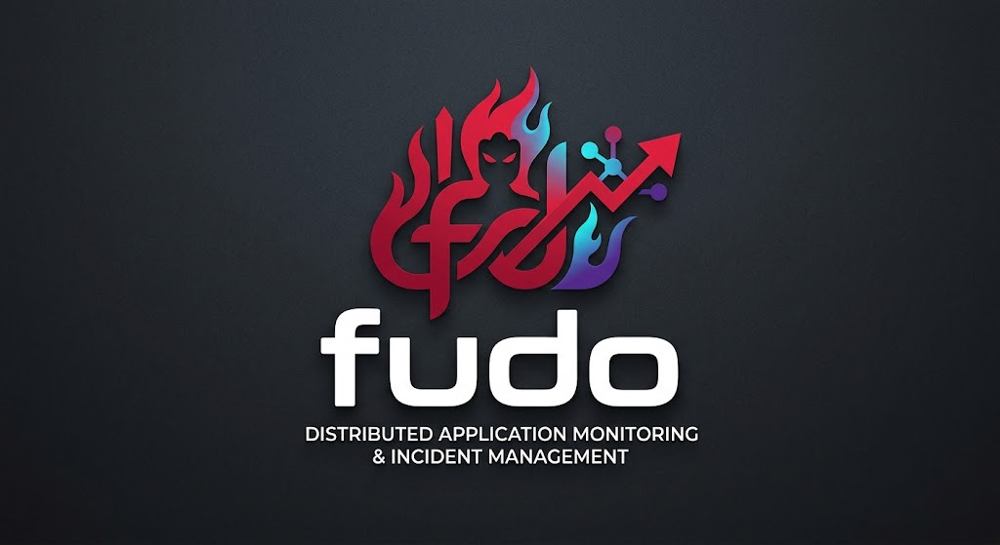
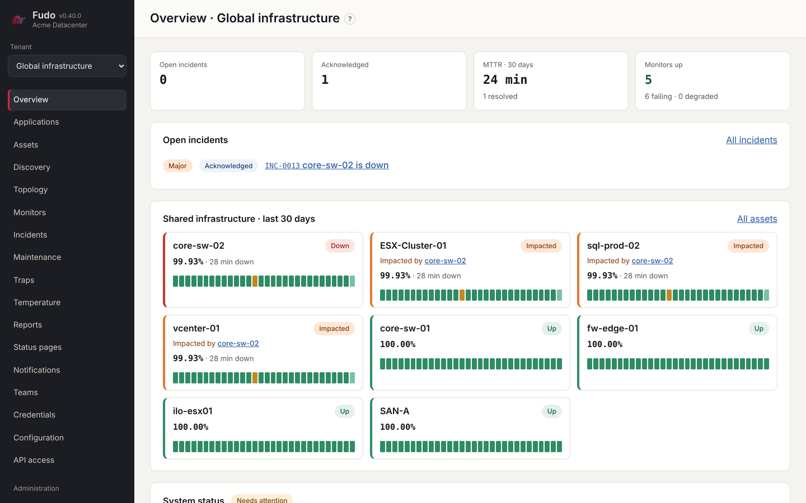

<p align="center"></p>

# Fudo

**Self-hosted monitoring and incident management for infrastructure teams** that run shared
infrastructure for several business units.

> *Fudō Myō-ō, the "Immovable One", stands amid flames holding a sword that cuts through illusion
> and a rope that binds chaos.* Fudo cuts through alert noise to the real root cause, and binds
> incidents to the knowledge that resolves them.

<p align="center"></p>

## Why Fudo

- **One alert per root cause.** Model what depends on what (applications → servers → switches,
  storage, clusters). When a core switch fails, you get one incident for the switch, with the
  impacted applications linked to it, not fifty alerts.
- **Built for shared infrastructure.** Tenants (business units) have their own applications,
  channels and reports; shared infrastructure is managed once, in a global scope, and shows up
  as the cause in every tenant it affects.
- **Incidents that remember.** Resolution notes come back on similar incidents and are quoted in
  their alerts: *"Last time this was resolved by …"*.
- **Infrastructure checks included.** HTTP(S), TLS, ping, TCP, DNS, SNMP, NTP, SMTP, domain
  expiry, databases, SSH, Docker, vCenter VMs, HPE iLO / Redfish, and push heartbeats.
- **Notifications where you are.** Email, Teams, Slack, webhooks and 100+ more (Telegram,
  PagerDuty, SMS, …), routed per tenant, per application and by severity, with escalation chains.
- **Availability and SLA reports.** 24/7 and business hours, PDF and CSV, emailed on a schedule.
- **Everything in the browser.** Setup wizard, users with mandatory 2FA, audit log,
  configuration as YAML, maintenance windows, live dashboards and a dependency map.
- **Backups you can move.** Encrypted backups made on demand or on a schedule, restored from the
  browser, on the same or a new server.
- **Your language, your look.** 13 languages (including right-to-left Arabic) and themes, both
  extendable by dropping in a file.

## Quick start

```bash
git clone https://github.com/labrouss/fudo.git && cd fudo
cp .env.example .env    # set POSTGRES_PASSWORD, APP_SECRET (openssl rand -base64 48) and PUBLIC_URL
docker compose up -d --build
```

Open `http://<host>:8080` and follow the setup wizard. Details: [Installation](docs/admin/installation.md).

## Documentation

- **Website**: [`site/`](site/README.md), published on GitHub Pages by `.github/workflows/pages.yml`.
- **User guide**: [Getting started](docs/guide/getting-started.md) · [Concepts](docs/guide/concepts.md) ·
  [Monitors](docs/guide/monitors.md) · [Incidents](docs/guide/incidents.md) ·
  [Notifications](docs/guide/notifications.md) · [more…](docs/README.md). Also built into Fudo under **Help**.
- **Administration**: [Installation](docs/admin/installation.md) ·
  [Upgrading and backup](docs/admin/upgrading-and-backup.md) ·
  [Configuration](docs/admin/configuration.md) · [Security](docs/admin/security.md)
- **API**: built in at `/api/docs`; specification at `/api/openapi.json`
- **Contributing**: [CONTRIBUTING.md](CONTRIBUTING.md) · [Development](docs/development.md) ·
  [Translations](locales/README.md) · [Themes](themes/README.md)

## Stack

TypeScript on Node.js 22 · Fastify · React · PostgreSQL 17 with TimescaleDB · pg-boss ·
Docker Compose. See [Development](docs/development.md).

## Changelog

See [CHANGELOG.md](CHANGELOG.md).

## License

Fudo is free software, licensed under the **GNU Affero General Public License v3.0 or later**
([LICENSE](LICENSE)). You may use, study, change and share it. If you run a **modified** version
for other people over a network, you must offer them the source code of your version (the
interface links to it under **Help**). Bundled third-party parts keep their own licenses (below).

## Third-party notices

- Notification providers and their translations from [Uptime Kuma](https://github.com/louislam/uptime-kuma)
  (MIT License, © Louis Lam), vendored unmodified in `packages/kuma-notifications/`; license in
  `packages/kuma-notifications/LICENSE`.
- [DejaVu fonts](https://dejavu-fonts.github.io/) for PDF reports (Bitstream Vera / DejaVu
  license), in `packages/report-fonts/`; license in `packages/report-fonts/LICENSE-DejaVu`.
- Logo artwork: project owner.
